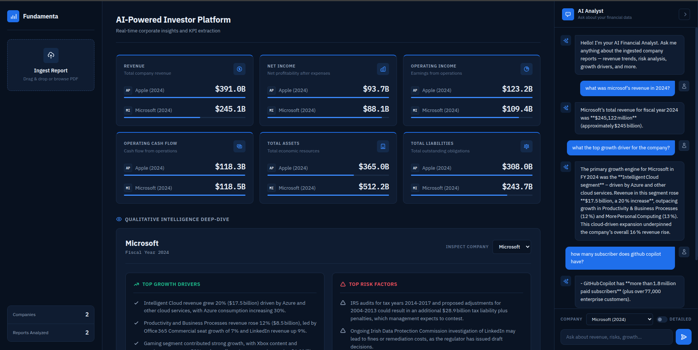

# AI Investor Platform

An AI-powered platform that turns corporate financial reports (10-K, annual reports) into structured insights — combining RAG-based conversational search with an executive dashboard.



## Main Objective

Investors and analysts spend hours reading hundreds of pages of financial reports to find key figures, risks, and growth drivers. This platform automates that work: upload a PDF report, and the system extracts the KPIs, identifies risks and growth drivers, and lets you ask questions in natural language — with answers grounded strictly in the document.

## Key Features

- **Document Ingestion** — Upload a PDF report; the pipeline converts it to markdown, chunks it semantically, embeds it, and stores it in a vector database (Pinecone)
- **AI Chat (RAG)** — Ask questions in plain English; answers are retrieved from the report chunks via hybrid search (vector + BM25), with anti-hallucination safeguards (temperature = 0, strict numeric rules, concise/detailed modes)
- **KPI Extraction** — LLM-powered extraction of revenue, net income, cash flow, total assets/liabilities, top risk factors, and growth drivers — saved to PostgreSQL
- **Dashboard** — Structured overview of all ingested companies with financial metrics and qualitative insights (growth drivers, risk factors)
- **Company/Year Filtering** — Scope chat and retrieval to a specific report

## The Value

The platform enables investors and analysts to reduce the time spent reviewing financial reports while improving access to critical business insights.
By automating document analysis, providing conversational access to information, and presenting insights in a structured dashboard, the solution supports faster decision-making, improved productivity, and a better overall user experience.

## How It Works

```
PDF Upload → Markdown → Semantic Chunking → Embeddings → Pinecone (vector store)
                                                      ↓
Dashboard ← PostgreSQL ← KPI Extraction ← RAG + LLM ←┘
    ↑
Chat ← Hybrid Retrieval (vector + BM25) ← Pinecone
```

## Tech Stack

| Layer | Technology |
|---|---|
| Backend | FastAPI, Python 3.12 |
| LLM | Groq (OpenAI-compatible API) |
| Embeddings | BAAI/bge-small-en-v1.5 (local, cached) |
| Vector Store | Pinecone |
| Database | PostgreSQL |
| Frontend | Jinja2 templates, vanilla JS/CSS |
| Deployment | Docker, docker-compose |
| Package Install | uv (fast Rust-based pip replacement, used in Docker builds) |

## Quick Start

```bash
# 1. Configure environment — fill in API keys (Groq, Pinecone, Postgres)
vim .env

# 2. Build and run (on first start the embedding model auto-downloads
#    into ./.cache/models — shared with the container, so only once)
docker compose up -d --build

# 3. Open the app
# Dashboard: http://localhost:8000
```

Or run locally without Docker:

```bash
python -m venv .venv
source .venv/bin/activate

# pip works fine; uv (https://docs.astral.sh/uv/) is faster if you have it:
# uv pip install -r requirements.txt
pip install -r requirements.txt

uvicorn app:app --reload --port 8000
```

> On startup the app handles everything automatically: creates the Postgres
> table, downloads the embedding model (first time, into `./.cache/models`),
> and creates the Pinecone index if missing.

## Usage

1. **Upload a report** — `POST /api/upload` with a `YYYY_Company.pdf` file (e.g. `2024_Tesla.pdf`)
2. **Explore the dashboard** — financial metrics, growth drivers, risk factors per company
3. **Chat** — ask questions like *"What are the main risk factors?"* — optionally scoped by company/year, with a **Detailed** toggle for in-depth answers

## Project Structure

```
├── app.py                  # FastAPI entrypoint
├── config.py               # Central configuration
├── routes/                 # API endpoints (chat, dashboard, ingestion, health)
├── ingestion/              # PDF→Markdown, semantic chunking, embeddings
├── rag/                    # KPI extraction pipeline
├── vectorstore/            # Pinecone store + hybrid retriever
├── database/               # PostgreSQL models & queries
├── llm/                    # LLM client (Groq)
├── data/                   # Raw PDFs + generated markdown
└── templates/, static/     # Dashboard UI
```
